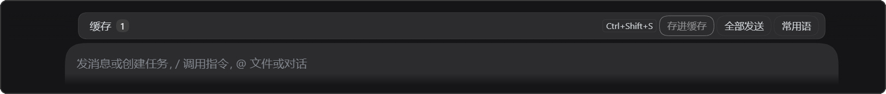
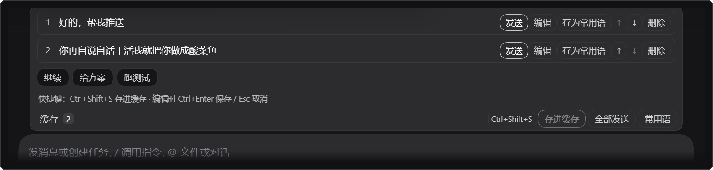

# dsh-cache-queue

[](LICENSE)
[](package.json)
[](https://github.com/yangzhuyi2026/dsh-cache-queue/actions/workflows/ci.yml)

A **hold-and-send** queue for the DSH (DeepSeek Harness) composer: park a message in the cache, send it only
when you click, and turn saved phrases into queued messages with one click. The Enter key behaves exactly as before.

> [!IMPORTANT]
> Restart DSH once after installing. Client bundles are not hot-reloaded.

<p align="center">
  
</p>

<p align="center"><sub>① Collapsed: one line next to the native queue strip, never covering the composer</sub></p>

<p align="center">
  
</p>

<p align="center"><sub>② Expanded: hover the strip and the panel grows upward in place, holding the entries, phrases and shortcut hints; click the title to pin it open</sub></p>


## Contents

- [What it is](#what-it-is)
- [Features](#features)
- [Prerequisites](#prerequisites)
- [Quick start](#quick-start)
- [Usage](#usage)
- [Configuration](#configuration)
- [Data and privacy](#data-and-privacy)
- [Relation to the native queue](#relation-to-the-native-queue)
- [Troubleshooting](#troubleshooting)
- [Uninstall](#uninstall)
- [Compatibility](#compatibility)
- [Develop and test](#develop-and-test)
- [Layout](#layout)
- [Contributing](#contributing)
- [License](#license)

## What it is

DSH has exactly one queue. While the agent is running, Enter puts the text in the native queue and it is
**guaranteed** to be delivered when the turn ends; while idle, Enter starts a turn immediately. "Write it down now,
decide later" is not something the host inbox can do.

This plugin keeps the text outside the session instead: cache entries live in the plugin's own local JSON and are
submitted through `conversation.send(...)` only when you click Send. It does not take over, modify, or remove
anything in the native queue — it is a second, parallel channel.

## Features

| Feature | Description |
| --- | --- |
| Store | Moves the composer text into the cache and clears the composer; disabled on an empty composer |
| Send one | Submits through `conversation.send(...)` and removes the entry only after the send lands |
| Send all | Sends top to bottom, stopping at the first failure |
| Edit / reorder / delete | `Ctrl+Enter` saves, `Esc` cancels; move up and down; delete asks twice |
| Phrases | A chip row at the bottom; a click turns the phrase into a cache entry; add, edit, remove; any entry can be saved as a phrase |
| Per conversation | Entries belong to the conversation that stored them; phrases are shared by all |
| Persistent | Survives reloads and restarts; host-side JSON with a `localStorage` fallback |
| No toasts | Leaves the composer notice area alone; results show in the list and button states |

## Prerequisites

| Item | Requirement |
| --- | --- |
| DSH | Web build with the `plugin_manager` tool available in a conversation (verified on `0.2.1-rc.3`) |
| OS | Windows / macOS / Linux |
| Git | To clone the repo; download the ZIP instead if you prefer |
| Node.js | 20 or newer — **only for running tests and developing**, not for installing the plugin |

## Quick start

### 1. Clone the repository anywhere

```bash
git clone https://github.com/yangzhuyi2026/dsh-cache-queue.git
```

### 2. Install the bundle from DSH

Open any DSH conversation and ask it to run (replace `target` with the **absolute path** you just cloned to):

```
plugin_manager { action: "install_bundle", target: "D:\\tools\\dsh-cache-queue" }
```

### 3. Restart DSH

Quit it completely and start it again. Client plugins load at startup only.

### 4. Verify

In a **brand-new conversation** the strip is hidden by default (so it does not take a row in every new chat).
Press <kbd>Ctrl</kbd>+<kbd>Shift</kbd>+<kbd>S</kbd> to store one entry and the `缓存 1` strip appears above the
composer — that means it works.

## Usage

| Action | How |
| --- | --- |
| Store | Write in the composer, click **存进缓存**, or press <kbd>Ctrl</kbd>+<kbd>Shift</kbd>+<kbd>S</kbd> |
| Expand | Hover the strip; it collapses 0.15 s after the pointer leaves; click the title to pin it open |
| Send one | Click **发送** on that entry |
| Send all | Click **全部发送** at the top right |
| Edit | Click **编辑**, <kbd>Ctrl</kbd>+<kbd>Enter</kbd> saves, <kbd>Esc</kbd> cancels |
| Reorder | Click **↑** / **↓** |
| Delete | Click **删除** twice |
| Use a phrase | Click a chip at the bottom — it becomes a cache entry (still not sent) |
| Manage phrases | Click **常用语** to add, edit, or remove them |
| Save as phrase | Any entry's **存为常用语**; the button greys out when the text already exists |

A full round trip:

1. Type "check this error for me" and click **存进缓存** — the composer clears and the cache gains one entry;
2. Keep typing and press Enter as usual; the two channels never interfere;
3. When ready, hover the strip and click **发送** on that entry;
4. To send everything, click **全部发送** — it goes top to bottom.

## Configuration

The plugin row accepts two optional keys (in the DSH plugin config, or your own `cordis.patch.yml`):

| Key | Default | Meaning |
| --- | --- | --- |
| `dshHome` | `$DSH_HOME`, usually `~/.dsh` | Data directory |
| `file` | `<dshHome>/cache-queue.json` | Explicit path to the data file |

Example:

```yaml
- insert:
    - id: cache-queue
      name: 'dsh-cache-queue'
      config:
        file: 'D:/dsh-data/cache-queue.json'
```

## Data and privacy

- **Location**: `%USERPROFILE%\.dsh\cache-queue.json` on Windows, `~/.dsh/cache-queue.json` elsewhere;
- **Shape**:

  ```json
  {
    "items":   [{ "id": "i-...", "sessionId": "session id", "text": "message text", "createdAt": 1760000000000 }],
    "phrases": [{ "id": "p-...", "label": "Continue", "text": "Continue" }]
  }
  ```

- **Writes**: temp file + rename behind a serialized queue, so a crash never leaves half a file and concurrent
  saves never overwrite each other;
- **Fallback**: the browser keeps a `localStorage` copy so the list still renders while the host endpoint is
  unavailable; the host wins once it is back;
- **Local only**: no network requests, no reading of conversation content, no attachments. The cache holds only
  plain text you typed.

## Relation to the native queue

| | Native queue (Enter while busy) | This cache |
| --- | --- | --- |
| When it sends | Always, when the turn ends | Only when you click Send |
| Where it lives | Host session queue | Plugin's own local JSON |
| Editable | Retractable, but delivery is certain | Fully editable and reorderable |
| Enter semantics | Untouched | Untouched |

## Troubleshooting

| Symptom | Likely cause | Fix |
| --- | --- | --- |
| Nothing above the composer after restart | New conversations hide the strip by default | Press <kbd>Ctrl</kbd>+<kbd>Shift</kbd>+<kbd>S</kbd> to store one, or use an existing conversation |
| Installed but nothing happens | DSH was not restarted | Quit completely and start again |
| Plugin row errors / fails to load | The plugin directory moved or was deleted | Run `install_bundle` again with the new path, then restart |
| Strip sits in a strange place or covers the composer | Host version difference | Open an issue with your DSH version |
| Cache is empty after restart | Data file not writable or deleted | Check that `~/.dsh/cache-queue.json` exists and is writable |
| Does not load after upgrading | Before 0.1.0 the package name was `@local/dsh-cache-queue` | `remove_bundle` the old one, `install_bundle` the new one, restart |

## Uninstall

1. Run `plugin_manager { action: "remove_bundle", target: "dsh-cache-queue" }` in a DSH conversation;
2. Restart DSH;
3. Optionally delete `~/.dsh/cache-queue.json` to drop the stored data.

## Compatibility

- Verified against DSH `0.2.1-rc.3` (`@deepseek-ai/dsh-client-ui-conversation` 0.2.1-rc.3);
- Registers in `conversation.input.dock` with id `cache-queue` and order 25 (native queue 20, genui panel 50), so
  it shadows nothing;
- Sends through `ctx.sessions.scope(sessionId).get('conversation').send(text)`;
- Uses only public plugin surfaces (`slots`, `locale`, `sessions`, `webServer`); no host code is patched.

## Develop and test

No dependencies, Node 20+:

```bash
npm run check   # syntax check
npm test        # both offline suites, 30 checks
```

Expected tail:

```
19/19 passed
18 passed, 0 failed
```

`test/client.test.mjs` loads `client.js` through `vm` with a tiny module loader and a minimal React
(`useState` / `useRef` / `useEffect` / `useCallback`), so no browser and no React install are needed.

Restart DSH to pick up client changes.

## Layout

```
index.js              Host half: JSON document, atomic writes, POST /api/dsh-cache-queue, cacheQueue service
client.js             Client half: the strip and panel inside conversation.input.dock
cordis.patch.yml      Inserts the cache-queue plugin row
locale/zh.json        Chinese title / description for the plugin market
locale/en.json        English title / description
icon.svg              Plugin icon
test/host.test.mjs    Host tests over a real HTTP server (19 checks)
test/client.test.mjs  Client tests with a mini React renderer (18 checks)
```

## Contributing

1. Fork the repo and work on a branch;
2. `npm test` must be green (CI runs it on Node 20 and 22);
3. Open a pull request explaining what and why.

Issues are welcome: include the DSH version, a screenshot, and the relevant **redacted** fragment of
`~/.dsh/cache-queue.json`.

## License

[MIT](LICENSE)
