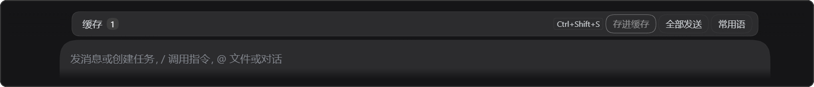
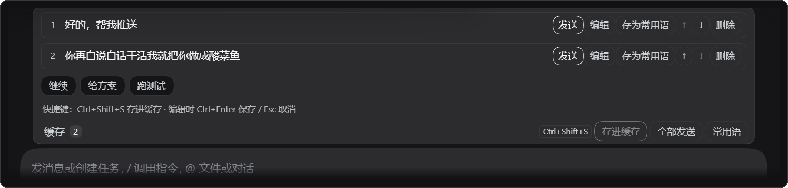

# dsh-cache-queue · 缓存队列

[](LICENSE)
[](package.json)
[](https://github.com/yangzhuyi2026/dsh-cache-queue/actions/workflows/ci.yml)

给 DSH（DeepSeek Harness）输入框加一条**只存、不发**的队列：写好的消息先躺在缓存里，你点了才发；
常用语点一下就能变成一条待发消息。回车的行为完全不变。

> [!IMPORTANT]
> 安装后需要**重启一次 DSH**，插件才会出现。客户端 bundle 不支持热更新。

<p align="center">
  
</p>

<p align="center"><sub>① 收起状态：只占一行，和原生「排队中」条并列，不挡输入框</sub></p>

<p align="center">
  
</p>

<p align="center"><sub>② 展开状态：鼠标移上去在原位向上展开，条目操作、常用语、快捷键提示都在这里；点标题可固定展开</sub></p>


## 目录

- [这是什么](#这是什么)
- [功能一览](#功能一览)
- [先决条件](#先决条件)
- [快速开始](#快速开始)
- [使用](#使用)
- [配置](#配置)
- [数据与隐私](#数据与隐私)
- [和原生排队的关系](#和原生排队的关系)
- [故障排查](#故障排查)
- [卸载](#卸载)
- [兼容性](#兼容性)
- [开发与测试](#开发与测试)
- [项目结构](#项目结构)
- [贡献](#贡献)
- [许可证](#许可证)

## 这是什么

DSH 原生只有一条队列。agent 忙时按回车，消息进「排队中」，本轮结束**必然**发出；空闲时按回车就直接开跑。
"先写下来，过一会儿再决定发不发"这件事，Host 的 inbox 做不到。

这个插件因此把文本保存在会话之外：缓存条目存在插件自己的本地 JSON 里，只有你在界面上点「发送」时，
才通过 `conversation.send(...)` 提交给 DSH。它不接管、不修改、也不删除原生「排队中」里的任何消息，
只是并列的第二条通道。

## 功能一览

| 功能 | 说明 |
| --- | --- |
| 存进缓存 | 读主输入框正文，进缓存并清空输入框；输入框为空时按钮是灰的 |
| 逐条发送 | 点某条的「发送」，提交成功后才从缓存里移除 |
| 全部发送 | 从上往下串行发出，任何一条失败就停下，不会跳过 |
| 编辑 / 排序 / 删除 | `Ctrl+Enter` 保存、`Esc` 取消；上移下移；删除要点两次 |
| 常用语 | 底部一排 chip，点一下变成一条缓存条目；可增删改；任意条目也能「存为常用语」 |
| 按对话隔离 | 缓存条目只属于存它的那个对话；常用语全局共享 |
| 持久化 | 刷新、重启都不丢，存 Host 侧 JSON，浏览器 `localStorage` 兜底 |
| 不打扰 | 不占用输入框下方的通知区，操作结果只体现在列表和按钮状态上 |

## 先决条件

| 项目 | 要求 |
| --- | --- |
| DSH | Web 版，且会话里能用 `plugin_manager` 工具（实测 `0.2.1-rc.3`） |
| 操作系统 | Windows / macOS / Linux |
| Git | 用来克隆仓库；不想装 Git 可以下载 ZIP 解压 |
| Node.js | 20 及以上——**只有跑测试和开发时需要**，单纯安装插件不需要 |

## 快速开始

### 1. 把仓库克隆到任意目录

```bash
git clone https://github.com/yangzhuyi2026/dsh-cache-queue.git
```

### 2. 在 DSH 里安装这个 bundle

新建或打开任意 DSH 对话，让它执行（`target` 换成上一步克隆出来的**绝对路径**）：

```
plugin_manager { action: "install_bundle", target: "D:\\tools\\dsh-cache-queue" }
```

### 3. 重启 DSH

完全退出再打开。客户端插件只在启动时加载。

### 4. 验证

在**新对话**里，缓存条默认是隐藏的（避免刚开对话就被占一行）。按 <kbd>Ctrl</kbd>+<kbd>Shift</kbd>+<kbd>S</kbd>
存进第一条，输入框上方就会冒出「缓存 1」——看到它就说明装好了。

## 使用

| 操作 | 怎么做 |
| --- | --- |
| 存进缓存 | 主输入框写完，点「存进缓存」，或按 <kbd>Ctrl</kbd>+<kbd>Shift</kbd>+<kbd>S</kbd> |
| 展开面板 | 鼠标移到缓存条上；移开 0.15 秒自动收起；点标题可固定展开（状态会记住） |
| 发送一条 | 点该条的「发送」 |
| 全部发送 | 点右上角「全部发送」 |
| 编辑 | 点「编辑」，<kbd>Ctrl</kbd>+<kbd>Enter</kbd> 保存，<kbd>Esc</kbd> 取消 |
| 排序 | 点「↑」「↓」 |
| 删除 | 点「删除」两次确认 |
| 用常用语 | 点底部 chip → 变成一条缓存条目（仍然等你点发送） |
| 维护常用语 | 点「常用语」进入面板，可增、改、删 |
| 存为常用语 | 任意缓存条目的「存为常用语」；正文重复时按钮变灰 |

一次完整流程：

1. 在主输入框写「帮我看看这个报错」，点「存进缓存」——输入框清空，缓存里多一条；
2. 继续写别的、照常按回车发送，互不影响；
3. 想发的时候，鼠标移到缓存条上，点那条的「发送」；
4. 想全发，点「全部发送」，它会按从上到下的顺序一条条发。

## 配置

插件行支持两个可选项（在 DSH 的插件配置里，或自己的 `cordis.patch.yml` 中覆盖）：

| 键 | 默认值 | 说明 |
| --- | --- | --- |
| `dshHome` | `$DSH_HOME`，通常是 `~/.dsh` | 数据目录 |
| `file` | `<dshHome>/cache-queue.json` | 直接指定数据文件路径 |

示例：

```yaml
- insert:
    - id: cache-queue
      name: 'dsh-cache-queue'
      config:
        file: 'D:/dsh-data/cache-queue.json'
```

## 数据与隐私

- **位置**：`%USERPROFILE%\.dsh\cache-queue.json`
  （macOS / Linux 为 `~/.dsh/cache-queue.json`）；
- **结构**：

  ```json
  {
    "items":   [{ "id": "i-...", "sessionId": "会话 id", "text": "要发的内容", "createdAt": 1760000000000 }],
    "phrases": [{ "id": "p-...", "label": "继续", "text": "继续" }]
  }
  ```

- **写入**：临时文件 + rename，并用串行队列串起来，断电不会写出半个文件，并发保存不会互相覆盖；
- **兜底**：浏览器里另存一份 `localStorage`，Host 接口暂时不可用时仍能显示，恢复后以 Host 为准；
- **只写本地**：不发任何网络请求、不读对话内容、不带附件。缓存里只有你自己写进去的纯文本。

## 和原生排队的关系

| | 原生「排队中」（agent 忙时回车） | 本插件的缓存 |
| --- | --- | --- |
| 什么时候发 | 本轮结束自动发 | 你点「发送」才发 |
| 存在哪 | Host 的会话队列 | 插件自己的本地 JSON |
| 能改吗 | 能撤回，但发出去是必然的 | 发之前随便改、随便排序 |
| Enter 语义 | 不动 | 不动 |

## 故障排查

| 现象 | 可能原因 | 处理 |
| --- | --- | --- |
| 重启后输入框上方什么都没有 | 新对话默认隐藏 | 按 <kbd>Ctrl</kbd>+<kbd>Shift</kbd>+<kbd>S</kbd> 存一条，或先在已有对话里用 |
| 装完没反应 | 没重启 DSH | 完全退出再打开 |
| 插件行报错 / 加载失败 | 插件目录被移动或删除 | 重新执行 `install_bundle` 指向新路径，再重启 |
| 缓存条位置很怪、挡住输入框 | DSH 版本差异 | 提 issue 并附 DSH 版本号 |
| 重启后缓存空了 | 数据文件不可写或被手动删除 | 检查 `~/.dsh/cache-queue.json` 是否存在、是否可写 |
| 从旧版升级后加载不出来 | 0.1.0 前包名是 `@local/dsh-cache-queue` | 先 `remove_bundle` 旧的，再 `install_bundle` 新的，然后重启 |

## 卸载

1. 在 DSH 对话里执行 `plugin_manager { action: "remove_bundle", target: "dsh-cache-queue" }`；
2. 重启 DSH；
3. 想连数据一起清掉，删除 `~/.dsh/cache-queue.json`（可选）。

## 兼容性

- 实测 DSH `0.2.1-rc.3`（`@deepseek-ai/dsh-client-ui-conversation` 0.2.1-rc.3）；
- 注册插槽 `conversation.input.dock`，id `cache-queue`，order 25（原生 queue 是 20、genui 面板是 50），
  不 shadow 任何已有条目；
- 发送走 `ctx.sessions.scope(sessionId).get('conversation').send(text)`；
- 依赖 DSH 的公开插件接口（`slots` / `locale` / `sessions` / `webServer`），未 patch 宿主代码。

## 开发与测试

不需要安装任何依赖，只需要 Node 20+：

```bash
npm run check   # 语法检查
npm test        # 两个离线测试套件，共 30 项
```

预期输出（最后两行）：

```
19/19 passed
18 passed, 0 failed
```

`test/client.test.mjs` 用 `vm` 加载 `client.js`，配一个最小 React
（`useState` / `useRef` / `useEffect` / `useCallback`）和迷你模块加载器，
所以不需要浏览器、也不需要安装 React。

改完代码要让 DSH 生效，需要重启一次。

## 项目结构

```
index.js              Host 半边：JSON 文档、原子写、POST /api/dsh-cache-queue、cacheQueue 服务
client.js             Client 半边：在 conversation.input.dock 里渲染细条与展开面板
cordis.patch.yml      插入插件行 cache-queue
locale/zh.json        插件市场里显示的中文名与描述
locale/en.json        English title / description
icon.svg              插件图标
test/host.test.mjs    Host 半边离线测试（真 HTTP server，19 项）
test/client.test.mjs  Client 半边离线测试（迷你 React 渲染，18 项）
```

## 贡献

1. Fork 本仓库，在分支上改动；
2. `npm test` 必须全绿（CI 会在 Node 20 / 22 上再跑一遍）；
3. 提 Pull Request，说明改了什么、为什么。

欢迎提 issue：附上 DSH 版本号、现象截图、以及 `~/.dsh/cache-queue.json` 里**脱敏后**的相关片段。

## 许可证

[MIT](LICENSE)
